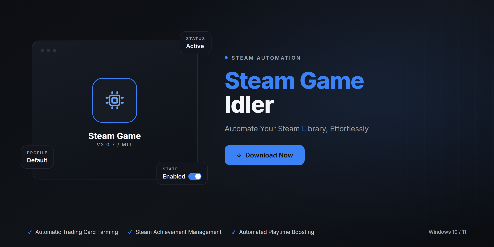
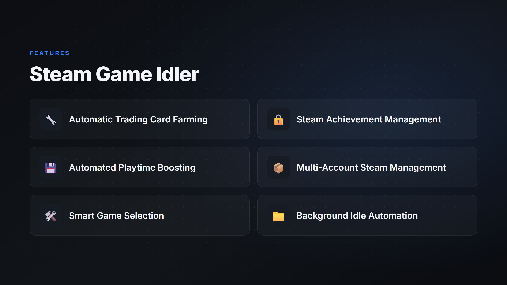

**Automate your Steam library. Collect cards, manage achievements, and boost playtime with one convenient desktop application.**

Steam Game Idler is a **free, open-source Steam automation tool for Windows** that helps PC gamers automate trading card farming, manage game achievements, and accumulate playtime. Bring essential Steam idling features together in an easy-to-use desktop interface — no command line or scripting required.

Whether you want to collect Steam trading cards, organize achievement management, or leave eligible games idling in the background, Steam Game Idler makes managing your Steam library simpler.

## ⬇️ Installation

**Download the Windows application**

1. Open the repository's [Releases](https://github.com/Basil0879/steam-game-idler/releases) page.
2. Download the latest release archive **`Steam Game Idler 4.0.4.zip`**.
3. Extract the archive into a folder of your choice.
4. Keep **`Steam Game Idler 4.0.4.exe`** and `libvlc.dll` together in that folder.
5. Double-click **`Steam Game Idler 4.0.4.exe`** to launch the application.

## ✨ Features

- 🃏 **Automatic Steam Trading Card Farming** — Automate Steam trading card drops from eligible games in your library and collect cards without manually launching every title.
- 🏆 **Steam Achievement Management** — Manage game achievements through an integrated desktop interface designed for convenient library management.
- ⏱️ **Steam Playtime Boosting** — Let supported games accumulate idle playtime without keeping individual games actively running on your desktop.
- 👥 **Multi-Account Steam Support** — Manage multiple Steam accounts and keep their automation activities organized in one application.
- ⚙️ **Intelligent Game Selection** — Choose which games participate in automation with configurable selection, exclusion, and prioritization options.
- 🔄 **Background Steam Automation** — Keep supported idling tasks running with minimal manual interaction.
- 🖥️ **User-Friendly Windows GUI** — Access Steam idling, card farming, and account management through a straightforward graphical desktop application.

## 🖼️ Overview

Explore the desktop interface and discover how the main Steam automation features fit together.

### All Your Steam Idling Tools in One Place

| Feature | What it does |
|---|---|
| Trading Card Farming | Automates eligible Steam card drops |
| Achievement Management | Provides achievement-related management tools |
| Playtime Automation | Accumulates idle time in supported games |
| Account Management | Organizes multiple Steam accounts |
| Game Selection | Controls which titles are included |
| Background Processing | Reduces repetitive manual interaction |

## 🚀 Usage

Getting started with Steam Game Idler is straightforward.

1. **Launch the application** — Open Steam Game Idler on your Windows PC.
2. **Connect your Steam account** — Select an available sign-in method and authenticate your account.
3. **Load your game library** — Allow the application to retrieve the games and account information needed for supported features.
4. **Configure card farming** — Select eligible games and adjust your preferred farming settings.
5. **Manage achievements and playtime** — Access the available game management and idling features.
6. **Start automation** — Activate the features you want and monitor their progress through the desktop interface.

### 💡 Tips for Better Steam Automation

- Review your game selection before starting card farming.
- Exclude games you do not want included in automation.
- Check account status if Steam authentication expires.
- Use separate account configurations when managing multiple Steam profiles.
- Keep the application updated to benefit from compatibility improvements.

## 🎮 Why Use a Dedicated Steam Idler?

Steam Game Idler brings several common Steam library management tasks into one desktop experience.

Instead of switching between separate utilities for card farming, playtime idling, and achievement management, you can access supported functionality from a centralized interface.

| Capability | Steam Game Idler |
|---|---|
| Steam trading card farming | Yes |
| Achievement management | Yes |
| Automated playtime idling | Yes |
| Multiple Steam accounts | Yes |
| Windows desktop interface | Yes |
| Command-line knowledge required | No |
| Open-source licensing | MIT |

### Who Is It For?

Steam Game Idler is designed for:

- **Steam collectors** interested in collecting trading cards and crafting badges.
- **Achievement enthusiasts** who want convenient achievement management.
- **PC gamers** looking for automated game idling and playtime management.
- **Multi-account users** who want to organize multiple Steam profiles.
- **Steam library enthusiasts** who prefer managing automation through a graphical interface.

## 🔒 Security & Privacy

Your Steam account deserves careful handling. Steam Game Idler is an open-source desktop application intended to provide transparent, user-controlled automation.

- **Open-source code:** The source code is available for inspection and independent auditing.
- **No telemetry or tracking:** The application does not include built-in analytics or behavioral tracking.
- **Account security:** Use supported authentication methods and protect your Steam credentials.
- **User-controlled automation:** Configure which games and features are active.
- **Transparent development:** Review changes and report unexpected behavior through GitHub Issues.

### Important Account Considerations

Steam Game Idler is an independent community-developed utility and is not affiliated with or endorsed by Valve Corporation.

Steam features and account functionality are subject to Valve's current policies and limitations. Automated activity may be restricted, and achievement modifications can affect game-specific statistics or community expectations.

Always review applicable Steam rules before using account automation features. Never share your password, authentication codes, or Steam Guard credentials with anyone.

### Reporting Issues

Found a bug, unexpected behavior, or compatibility problem?

1. Open the repository's Issues section.
2. Search for an existing report covering the same problem.
3. Create a new issue with a clear description.
4. Include relevant application logs and reproduction steps, but remove passwords, authentication codes, and other sensitive information.

Contributions, bug reports, and constructive suggestions are welcome.

## 🛠️ Technology & Development

Steam Game Idler is a desktop-focused application built around Steam integration and automation.

Its development emphasizes:

- A graphical interface for everyday Windows users.
- Steam-related account and library operations.
- Automated background task management.
- Maintainable, community-auditable source code.
- Ongoing compatibility and reliability improvements.

Developers interested in contributing can explore the source code, report bugs, and suggest improvements through the repository.

## ❓ Frequently Asked Questions

### Is Steam Game Idler free?

Yes. Steam Game Idler is an open-source desktop application distributed under the MIT License.

### Does it require the Steam desktop client?

The application supports account integration without requiring a locally running Steam client for its supported operations.

### Can I farm Steam trading cards automatically?

Yes. Its card farming functionality automates eligible trading card farming for supported games in your library.

### Can I manage multiple Steam accounts?

Yes. Multi-account support allows you to organize and manage automation activities across multiple accounts.

### Does Steam Game Idler run on Windows?

Yes. This repository targets Windows desktop users.

### Is it an alternative to ArchiSteamFarm or Idle Master?

Steam Game Idler provides an integrated graphical approach to Steam card farming and game idling, combining several commonly used Steam automation capabilities in one application.

### Does it guarantee Steam achievements or trading card drops?

No. Results depend on Steam eligibility, game restrictions, account status, and platform-side limitations.

## 🤝 Contributing

Community contributions help make open-source Steam automation better.

You can help by:

- Reporting reproducible bugs.
- Suggesting useful Steam integration features.
- Improving documentation.
- Testing application updates.
- Reviewing code and submitting pull requests.

Please keep contributions focused, clearly documented, and consistent with the project's existing architecture.

## 📄 License

Released under the **MIT License**. You are free to use, modify, and distribute the software in accordance with the license terms.

---

**Steam Game Idler — A simpler way to automate Steam trading card farming, achievement management, and game idling on Windows.**